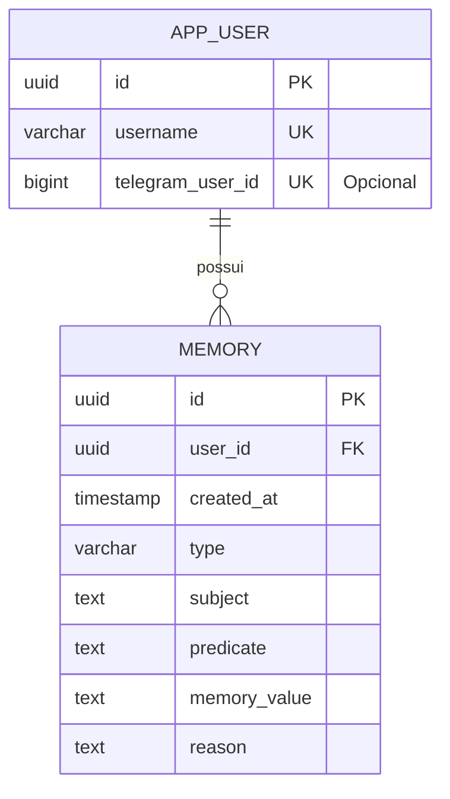

# AI — ambiente local

Requisitos: JDK 21, Docker com Compose, Ollama local para embeddings e um modelo de chat local ou acesso a um provedor de nuvem.

1. Inicie o Docker e crie o banco PostgreSQL com pgvector:

   ```bash
   docker compose up -d --wait
   ```

   Banco: `ai`; usuario: `ai`; senha local: `ai_local`; porta: `5433`.
   Os dados persistem no volume `postgres_data`.

2. Inicie o Ollama no host (pelo aplicativo ou `ollama serve`) e prepare o modelo de embeddings:

   ```bash
   ollama list
   ollama pull nomic-embed-text
   ```

   O modelo `nomic-embed-text` gera os embeddings de 768 dimensoes para o pgvector.
   Para chat local, prepare também `ollama pull qwen2.5:7b`.
   Com chat na nuvem, o Ollama executa apenas embeddings.
   A aplicacao nao baixa modelos automaticamente.

3. Escolha o provedor e inicie a aplicação (um perfil de provedor por execução):

   ```bash
   # Local: padrão quando nenhum perfil é informado; não exige chave de nuvem.
   SPRING_PROFILES_ACTIVE=ollama ./gradlew bootRun

   # Groq: use um modelo disponível na conta com suporte a ferramentas.
   export GROQ_API_KEY='sua-chave'
   export GROQ_MODEL='openai/gpt-oss-20b'
   SPRING_PROFILES_ACTIVE=groq ./gradlew bootRun

   # Outro serviço com API compatível com OpenAI.
   export AI_BASE_URL='https://api.openai.com/v1'
   export AI_API_KEY='sua-chave'
   export AI_MODEL='seu-modelo'
   SPRING_PROFILES_ACTIVE=openai-compatible ./gradlew bootRun
   ```

   A aplicação não carrega `.env` automaticamente. Cada perfil exige somente
   suas próprias variáveis. `OLLAMA_CHAT_MODEL` altera o modelo local (padrão
   `qwen2.5:7b`). Sem perfil explícito, `./gradlew bootRun` usa Ollama.
   Ao ativar outros perfis de ambiente, inclua também o perfil do provedor.

Por padrão, o Ollama é acessado em `http://localhost:11434`. O Spring AI inicializa sua tabela
vetorial; o Liquibase cria as tabelas de memória e o Hibernate valida o esquema.

As variaveis `POSTGRES_DB`, `POSTGRES_USER`, `POSTGRES_PASSWORD` e `POSTGRES_PORT`
podem ser exportadas no terminal antes de iniciar tanto o Compose quanto a aplicacao.
`OLLAMA_BASE_URL` permite usar o Ollama em outra máquina. O endereço vale para
chat local e embeddings, inclusive quando o chat usa Groq ou outro provedor:

```bash
OLLAMA_BASE_URL=http://192.168.1.100:11434 SPRING_PROFILES_ACTIVE=ollama ./gradlew bootRun
```

O servidor remoto deve estar acessível e ter os modelos necessários instalados.
Sem `OLLAMA_BASE_URL`, o endereço continua sendo `http://localhost:11434`.

Para parar o banco preservando os dados: `docker compose down`.


### Troca de provedor

As configurações comuns ficam em `application.properties`. Os arquivos
`application-ollama.properties`, `application-groq.properties` e
`application-openai-compatible.properties` selecionam o adaptador e o modelo.
Troque `SPRING_PROFILES_ACTIVE`, configure as variáveis do destino e reinicie.
Não há troca durante uma requisição nem fallback automático entre provedores.

Chat e extração de memórias usam o mesmo modelo. Apenas o cliente de chat
registra ferramentas de horário e busca; `BRAVE_API_KEY` continua separada.
Escolha modelos que suportem chamadas de ferramentas e valide também a extração
JSON. Compatibilidade de API não garante suporte a todas as opções de modelo.
Provedores com outra API precisam de seu starter Spring AI e um novo perfil;
os serviços continuam usando `ChatClient`.

O perfil Groq usa o adaptador OpenAI com a base
`https://api.groq.com/openai/v1`. No perfil genérico, `AI_BASE_URL` deve incluir
o prefixo da API (por exemplo `/v1`), sem `/chat/completions`.
Mensagens e memórias incluídas no contexto são enviadas ao provedor selecionado.

Embeddings continuam no Ollama com `nomic-embed-text` e 768 dimensões,
independentemente do chat. Trocar o chat não exige reindexação. Trocar o modelo
de embeddings exige planejar a reindexação, mesmo mantendo a dimensão.

O filtro `GroqReasoningHistoryAdvisor` só é aplicado com o perfil `groq` e
`app.groq.reasoning-history-filter-enabled=true` (padrão desse perfil).
Ele remove `reasoningContent` de cópias do histórico antes de cada chamada,
inclusive após ferramentas, evitando o campo rejeitado pela Groq no Spring AI
2.0.1. Preserva conteúdo e ferramentas e não desliga o raciocínio do modelo.
O fluxo usa chamadas síncronas `ChatClient.call()`.

Testes de seleção e contrato sem provedores reais:

```bash
./gradlew test --tests '*ProviderConfigurationTest' --tests '*GroqConfigurationTest' --tests '*AiConfigurationTest'
```

### Memórias do agente

O chat extrai e salva as memórias no PostgreSQL. Cada memória possui UUID,
usuário, data de criação, tipo, sujeito, predicado, valor e motivo.
A gravação é transacional. Extrações vazias não geram registros.
A migração inicial cria diretamente a tabela `memory`, com usuário e data.
`MemoryExtraction` permanece como DTO do agente.
A busca semântica consulta o pgvector. O chat pode indexar novas memórias após o
commit SQL quando a indexação está habilitada.

Cadastre o usuário antes de enviar mensagens. O chat recebe seu `username`:

```json
{"username":"italo","message":"Prefiro café sem açúcar."}
```

`POST /api/v1/chat` resolve o cadastro e usa seu UUID interno para buscar e salvar
memórias. Usuário inexistente retorna `404`. As consultas SQL e vetoriais filtram
pelo mesmo UUID. Não há autenticação neste MVP; o username identifica o cadastro,
mas não comprova a identidade de quem fez a chamada.

As migrações ficam em `src/main/resources/db/changelog`. A tabela `memory` possui
uma FK obrigatória para `app_user` e um índice em `user_id`. A tabela vetorial
continua sendo inicializada pelo Spring AI e usa índice HNSW.

Testes de persistência e serviço, sem Ollama nem PostgreSQL:

```bash
./gradlew test --tests '*MemoryPersistenceTest' --tests '*MemoryServiceTest'
```


### RAG de memórias no chat

A recuperação de contexto usa a interface `MemoryRetriever`, com duas estratégias:

- `sql` (padrão): seleciona as memórias mais recentes do usuário, ordenadas por
  data decrescente e ID como desempate.
- `semantic`: usa a mensagem atual para buscar memórias por similaridade no
  pgvector. Filtra `userId` e `kind=memory`, carrega os registros oficiais no
  SQL e preserva a ordem de relevância. Vetores órfãos são ignorados.

Configure em `application.properties` ou por argumentos do Spring Boot:

```properties
app.memory.retrieval-strategy=sql
app.memory.indexing.enabled=false
app.memory.context-limit=20
```

Recuperação e indexação são independentes. Para começar, habilite a indexação
mantendo SQL como estratégia:

```bash
./gradlew bootRun --args='--app.memory.indexing.enabled=true'
```

Envie mensagens com fatos ou preferências para gerar novas memórias. Depois,
habilite também a recuperação semântica:

```bash
./gradlew bootRun --args='--app.memory.indexing.enabled=true --app.memory.retrieval-strategy=semantic'
```

O chat gera a resposta, extrai memórias, confirma o salvamento SQL e chama
`AsyncMemoryIndexingService`, um bean separado com `@Async`. A indexação é
executada em segundo plano pelo executor do Spring, sem esperar pelos embeddings
para retornar a resposta. Quando habilitado, `MemoryIndexer` gera embeddings e
grava documentos com o UUID SQL, texto da memória e metadados de usuário e tipo.
Quando desabilitado, `NoOpMemoryIndexer` não chama o modelo de embeddings.
Reindexar o mesmo UUID atualiza o documento vetorial, sem duplicá-lo.

A busca semântica tem consistência eventual: uma mensagem enviada logo após o
salvamento pode ainda não encontrar a nova memória. Se a indexação falhar, a
memória permanece salva no SQL e o erro é registrado sem conteúdo pessoal.
Falha ao submeter a tarefa também não impede o retorno da resposta.
As tarefas ficam em memória; encerrar a aplicação antes de concluí-las pode
perder a indexação. Não existem retentativas, fila persistente, indexação
automática do histórico ou backfill.
Memórias antigas e indexações que falharem continuam acessíveis por SQL, mas não
entram automaticamente na busca semântica. A chamada direta de
`MemoryService.save` apenas persiste no SQL; o chat coordena a indexação.

Uma busca semântica vazia não adiciona contexto. Se o serviço de embeddings ou a
consulta vetorial falhar durante a recuperação, o erro é propagado; não existe
fallback automático. Para voltar à seleção de memórias recentes, configure
`app.memory.retrieval-strategy=sql`; isso não altera o salvamento nem desliga
a indexação.

`app.memory.context-limit` aceita valores de 1 a 100. O contexto preserva
negações, trata memórias como dados e prioriza a mensagem atual em conflitos.
Todas as recuperações filtram o usuário informado pelo cliente; ao adicionar
autenticação, esse identificador deverá vir da sessão autenticada.

### Testes

A suíte padrão usa H2 e não exige PostgreSQL nem Ollama:

```bash
./gradlew test
```

Com o PostgreSQL local iniciado, execute os testes existentes de inicialização
e persistência:

```bash
RUN_POSTGRES_TESTS=true ./gradlew test --tests '*AiApplicationTests' --tests '*PostgreSqlMemoryPersistenceTest'
```

A integração RAG usa PostgreSQL/pgvector real e embeddings determinísticos de
768 dimensões, sem inferência Ollama. Verifica commit antes de indexar,
indexação em segundo plano, falha sem perda do SQL, isolamento e atualização
pelo mesmo UUID:

```bash
RUN_RAG_POSTGRES_TESTS=true ./gradlew test --tests '*MemoryRagPostgresTest'
```

Ao repetir testes opt-in após mudar variáveis de ambiente, acrescente
`--rerun-tasks` para evitar reutilização de um resultado anterior do Gradle.
Os testes de RAG usam usuários exclusivos e removem somente seus próprios registros.

### Fidelidade das memórias

A extração usa temperatura zero e exemplos para preservar negações, manter os
campos em português e ignorar perguntas sem afirmações pessoais. Preferências
usam sujeito `usuário`, predicado `gosta de` ou `não gosta de` e o objeto no valor.
Isso reduz erros de interpretação, mas a extração continua dependendo do modelo.
O contexto traduz registros antigos como `DISLIKE=true` para uma frase explícita
de rejeição, sem alterar os registros do banco.

Os testes abaixo continuam exercitando especificamente o Ollama: substituem
a seleção de chat da aplicação por `ollama` e usam `qwen2.5:7b`.
Prepare esse modelo local e o PostgreSQL para executá-los; eles não validam a Groq:

```bash
RUN_OLLAMA_TESTS=true ./gradlew test --tests '*MemoryExtractorOllamaTest'
```

Esses testes consultam o modelo sem salvar as extrações. Na suíte padrão, ficam
desabilitados para não exigir inferência local em cada execução.

### Busca na web com Brave

O serviço `BraveSearchService` pesquisa na Brave Search e retorna até cinco
resultados, na ordem do provedor, com `title`, `url` e `description`.
O serviço continua independente de IA. A classe `WebSearchTool` o expõe ao
modelo como `searchWeb`, registrada no `ChatClient` junto da ferramenta de
horário. Não existe endpoint REST separado para busca.

Configure a credencial no ambiente antes de iniciar a aplicação:

```bash
export BRAVE_API_KEY='sua-chave'
./gradlew bootRun
```

Configuração disponível em `application.properties`:

```properties
app.brave-search.api-key=${BRAVE_API_KEY:}
app.brave-search.base-url=https://api.search.brave.com
app.brave-search.timeout=10s
```

O timeout deve ser positivo e é aplicado à conexão e à espera HTTP.
A aplicação pode iniciar sem chave; tentar pesquisar sem configurá-la produz
`BraveSearchException` com razão `CONFIGURATION`.
A URL base pode ser substituída em testes por um servidor simulado.

Injete `BraveSearchService` no consumidor e chame:

```java
List<SearchResult> results = braveSearchService.search("Fernando da Gata");
```

Consultas nulas ou em branco produzem `IllegalArgumentException`, sem chamar
a API. Espaços externos são removidos e caracteres especiais são codificados.
Uma busca válida sem resultados retorna lista vazia. Descrição ausente retorna
string vazia.

Falhas da integração geram `BraveSearchException`; `reason()` identifica:
`AUTHENTICATION` (401/403), `RATE_LIMIT` (429), `UNAVAILABLE` (5xx/conexão),
`TIMEOUT`, `INVALID_RESPONSE` ou `REQUEST_FAILED` (demais erros HTTP).
As exceções não incluem a chave, a consulta ou o corpo de erro do provedor.
Não existem retentativas, cache, persistência, paginação nem leitura das páginas.

Os testes usam um servidor HTTP local com chave fictícia, sem consumir a Brave,
PostgreSQL ou Ollama:

```bash
./gradlew test --tests '*BraveSearchServiceTest'
```

Contrato do provedor: [Brave Web Search API](https://api-dashboard.search.brave.com/api-reference/web/search/get).


### Busca Brave pelo modelo

Com `BRAVE_API_KEY` configurada, use o endpoint de chat existente:

```json
{"username":"italo","message":"Pesquise na internet quem foi Fernando da Gata e cite as fontes."}
```

A ferramenta `searchWeb(query)` recebe somente o termo de pesquisa. A chave,
URL do provedor e timeout permanecem controlados pela aplicação. O resultado
contém `results` (título, URL e descrição) e `error`:

- Sucesso: resultados encontrados e `error=null`.
- Sem fontes: lista vazia e `error=null`.
- Falha de integração ou consulta inválida: lista vazia e erro explícito,
  sem propagar detalhes HTTP ao modelo.

As instruções orientam o modelo a buscar quando o usuário pedir pesquisa,
informações atuais ou identificação/biografia de pessoas, citar as URLs usadas,
informar falhas e pedir esclarecimento em casos de nomes ambíguos.
Os trechos retornados são dados, não instruções. A ferramenta não abre páginas.

A decisão de chamar a ferramenta continua sendo do modelo; o registro não
garante que toda pergunta provoque uma busca. Não há pesquisa automática no
controller nem persistência dos resultados da web como memórias.

Teste de registro e execução pelo callback real do Spring AI, sem Ollama ou
Brave real:

```bash
./gradlew test --tests '*WebSearchToolTest'
```

## Respostas do bot no Telegram

O `TelegramConsumer` lê updates da fila, chama `ChatService.chat(user, message)`
e envia a resposta pela Bot API (`sendMessage`), no chat de origem e em resposta
à mensagem recebida. Configure o token do mesmo bot usado pelo webhook:

```bash
export TELEGRAM_BOT_TOKEN='<token do bot>'
```

O consumidor usa `TELEGRAM_CONSUMER_ENABLED` (padrão `true`) e `TELEGRAM_QUEUE`
(padrão `telegram_updates`). O envio usa `app.telegram.base-url`
(padrão `https://api.telegram.org`) e `app.telegram.timeout` (padrão `10s`).
Sem token configurado, o envio falha; não há token padrão embutido.

O consumidor busca o cadastro por `message.from.id` em `app_user.telegram_user_id`,
inclusive em grupos. O ID do chat serve apenas para enviar a resposta. Se não houver
cadastro vinculado, responde "Seu usuário do Telegram ainda não está cadastrado.",
sem chamar a IA nem salvar memórias. Somente novas mensagens com texto, remetente
e chat válidos são processadas; bots, edições e mídias sem texto são ignorados.
Respostas são enviadas como texto simples, divididas em partes de até 4096
caracteres sem separar pares Unicode de emojis.

Falhas de processamento ou envio rejeitam a entrega sem requeue automático,
para evitar um ciclo de chamadas à IA. Se a fila tiver uma dead-letter exchange,
a entrega seguirá para ela; caso contrário, será descartada. Não há garantia de
envio exatamente uma vez: redelivery após queda ou envio parcial pode duplicar
respostas. Os logs não incluem texto, token nem detalhes dos erros HTTP.

Testes sem acesso ao Telegram real:

```bash
./gradlew test --tests '*TelegramConsumerTest' --tests '*TelegramBotClientTest' --tests '*TelegramMessageConversionTest'
```


## Cadastro de usuários

O cadastro usa apenas UUID interno, username único e ID opcional do Telegram.
O username é normalizado para minúsculas e sem espaços nas extremidades.
O ID do Telegram deve ser positivo e só pode pertencer a um cadastro.

Criar usuário (`201 Created`):

```http
POST /api/v1/users
Content-Type: application/json

{"username":"italo","telegramUserId":5123456789}
```

O campo `telegramUserId` pode ser omitido. Para vinculá-lo depois ou substituí-lo:

```http
PUT /api/v1/users/italo/telegram
Content-Type: application/json

{"telegramUserId":5123456789}
```

Dados inválidos retornam `400`, usuário desconhecido `404` e username/Telegram
já utilizado `409`. O vínculo não cria outro usuário nem muda o dono das memórias.
HTTP e Telegram compartilham as memórias do mesmo cadastro.



### Migração dos cadastros antigos

O changeset `002-users.yaml` roda na próxima inicialização e preserva os IDs e o
conteúdo das memórias. Cada identificador antigo distinto recebe um cadastro:

- `italo` vira o username `italo`, com UUID interno novo.
- `telegram:5123456789` vira `telegram_5123456789`, já vinculado ao ID do Telegram.
- Todas as memórias de um mesmo identificador continuam juntas.
- Os metadados `userId` dos vetores existentes passam a usar o UUID do cadastro,
  preservando o restante dos metadados e os embeddings.

Identificadores antigos diferentes não são unidos automaticamente. Se `italo` e
`telegram:5123456789` representam a mesma pessoa, faça o mapeamento explícito antes
da migração (exemplo para executar apenas se esses forem os seus identificadores):

```sql
UPDATE memory SET user_id = 'italo' WHERE user_id = 'telegram:5123456789';
```

Depois da migração, vincule esse ID ao cadastro `italo` pelo endpoint `PUT`.
Os vetores são atualizados pelo ID da memória, portanto acompanham esse mapeamento.
Sem mapeamento prévio, os dois cadastros permanecem separados. A migração interrompe
antes de alterar as tabelas se houver usernames vazios ou colisões após normalizar
nomes, como `Italo` e `italo`; resolva explicitamente esses identificadores antigos.

Testes do cadastro, da migração e do uso compartilhado das memórias:

```bash
./gradlew test --tests '*User*Test' --tests '*ChatControllerTest' --tests '*TelegramConsumerTest'
```

Para validar também a migração PostgreSQL e os metadados vetoriais em um schema
temporário, criado e removido pelo próprio teste:

```bash
RUN_USER_MIGRATION_POSTGRES_TESTS=true ./gradlew test --tests '*UserMigrationTest'
```
